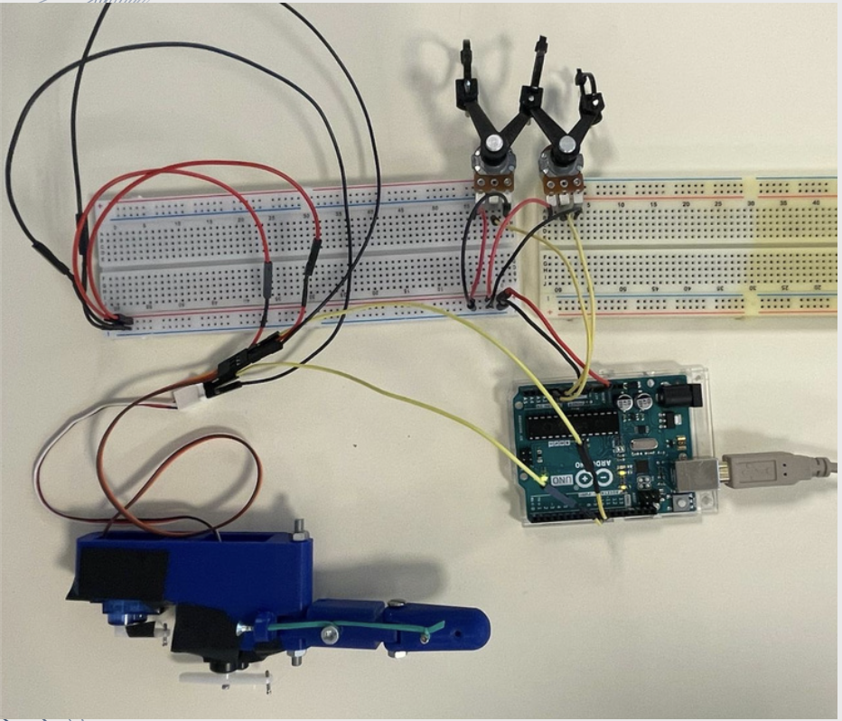
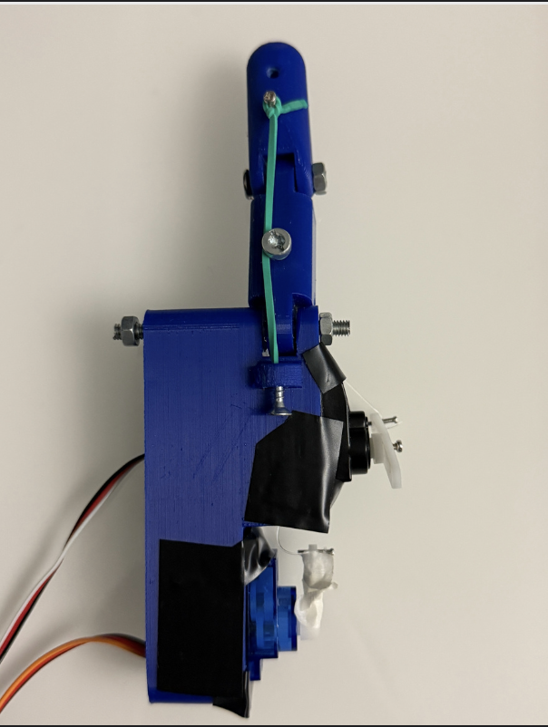
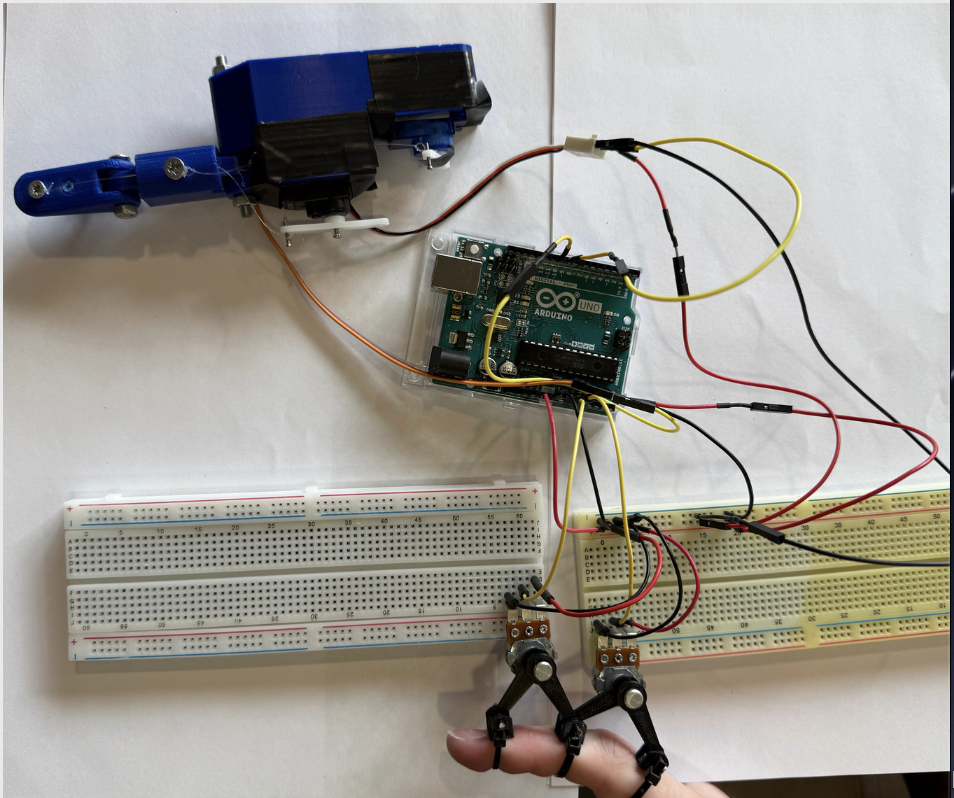
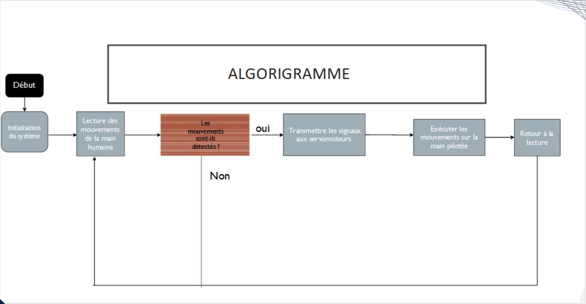
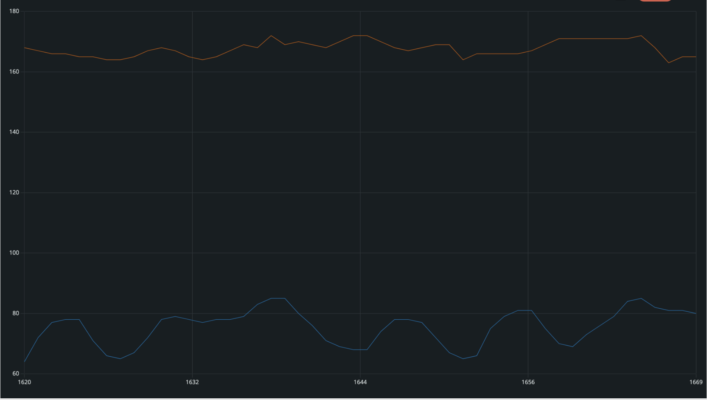
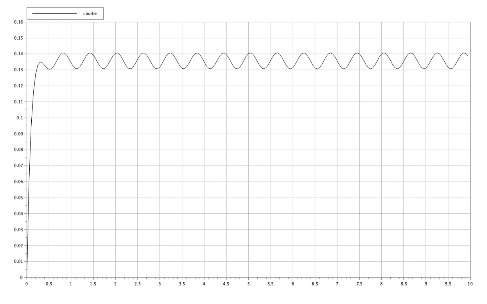
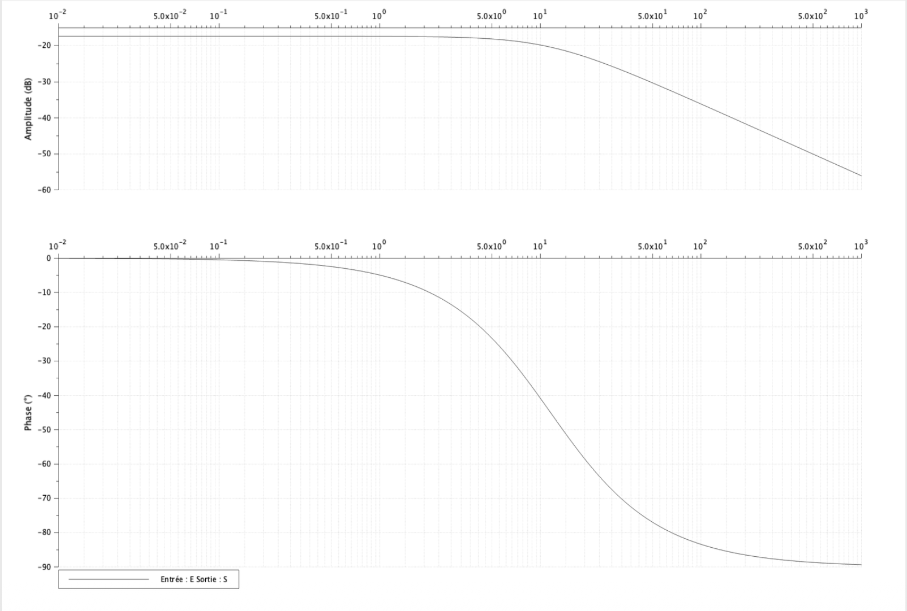
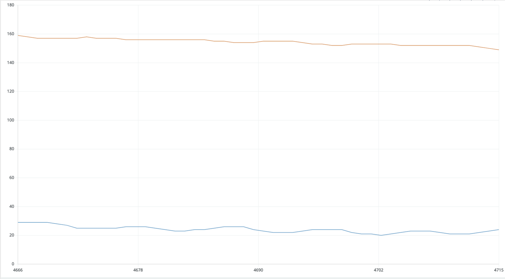
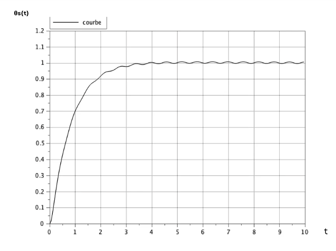
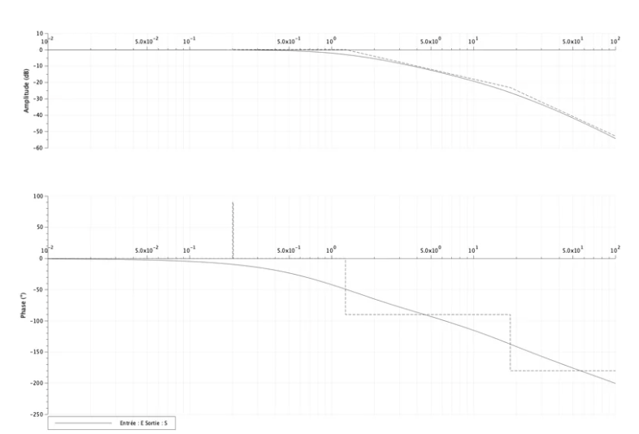

# Robotic Finger Control System

**Arduino | Embedded Systems | Robotics | Digital Signal Processing | Control Engineering**

## Project Overview

Inspired by the precision requirements of robot-assisted surgery, this TIPE research project investigates how involuntary finger tremors can affect the stability of a remotely controlled robotic finger.

For example, during remote surgery, unintended movements from a surgeon's fingers may be transmitted to robotic instruments, potentially affecting precision.

To investigate this challenge, I designed and fabricated a **3D-printed robotic finger**, controlled by an Arduino Uno using potentiometer sensors and servomotors.

**Objective:** Reduce unwanted oscillations through digital low-pass filtering while preserving responsiveness to intentional movements.

## My Contributions

- Designed, 3D-printed, and assembled the robotic finger prototype.
- Integrated potentiometer sensors, Arduino electronics, and servo-driven actuation.
- Developed Arduino programs for sensor acquisition and motor control.
- Implemented a first-order digital low-pass filter.
- Modeled the system and investigated sinusoidal disturbances.
- Analyzed time-domain responses and Bode diagrams before and after filtering.
- Evaluated the trade-off between disturbance rejection and response speed.

## System Architecture

**Human finger → Potentiometer sensors → Arduino Uno → Digital filtering → Servomotors → Robotic finger**

The Arduino acquires analog sensor signals and converts them into servo angle commands. The robotic finger is actuated through a cable-driven mechanism using fishing lines.

### Experimental Setup

### 3D-Printed Robotic Finger

### Sensor and Control Setup

### System Flowchart

## Engineering Approach

### 1. Disturbance Modeling

To investigate the influence of involuntary tremors, a sinusoidal disturbance was introduced into the simulated control system.

The input signal was modeled as:

$$
\theta(t)=u(t)+0.05\sin(10.43t)
$$

The disturbance frequency was approximately **1.66 Hz**.

Without filtering, the system was represented by a **third-order transfer-function model**.

The simulated time response showed persistent oscillations, demonstrating the effect of disturbances on motion stability.

### 2. Digital Low-Pass Filtering

A first-order recursive digital low-pass filter was implemented on the Arduino:

$$
y[n]=\alpha x[n]+(1-\alpha)y[n-1]
$$

Where:
- **x[n]**: raw sensor measurement
- **y[n]**: filtered output
- **α**: filtering coefficient

With a sampling interval of **50 ms**, the selected coefficient was **α = 0.1**.

The filter reduces rapid fluctuations in sensor measurements before generating servo commands.

In the control-system simulation, adding the low-pass filter increased the model order from **3 to 4**.

### 3. Dynamic and Frequency-Domain Analysis

Time-domain simulations and Bode diagrams were used to evaluate:

- The influence of sinusoidal disturbances.
- The attenuation of unwanted oscillations.
- Changes in frequency response.
- The effect of filtering on response speed.

## Arduino Implementation

Two Arduino programs were developed to compare robotic finger control with and without filtering.

**Before Filtering:** Raw potentiometer measurements are directly converted into servo commands.

[View Arduino Code — Before Filtering](arduino/before_filtering.ino)

**After Filtering:** Sensor measurements are smoothed using a digital low-pass filter before servo actuation.

[View Arduino Code — After Filtering](arduino/after_filtering.ino)

## Results and Analysis

### Before Filtering

The unfiltered system exhibits persistent oscillations under sinusoidal disturbances.

**Signal Analysis**

**Simulated Time Response**

**Bode Diagram**

### After Filtering

The low-pass filter attenuates unwanted oscillations and produces a smoother response, at the cost of increased response time.

**Filtered Signals**

**Simulated Time Response**

**Bode Diagram**

### Results Comparison

| Parameter | Before Filtering | After Filtering |
|---|---|---|
| Simulation model | 3rd order | 4th order |
| Disturbance oscillations | Persistent | Strongly attenuated |
| Simulated response time | ~0.22 s | ~3.4 s |
| Signal stability | Disturbed | Improved |
| Responsiveness | Faster | Slower |

The separate signal analysis also reported a reduction in oscillation amplitude from approximately **10° to 3°**, corresponding to a **70% reduction**.

This percentage describes signal oscillations, not a directly measured improvement in physical positioning accuracy.

**Key finding:** Digital low-pass filtering improves disturbance attenuation and command stability, but introduces additional response delay.

## Technical Skills

- **Embedded Systems:** Arduino, C/C++, analog signal acquisition, servo control
- **Signal Processing:** Digital low-pass filtering, sampling, disturbance analysis
- **Control Engineering:** Transfer functions, dynamic modeling, time-domain responses, Bode diagrams
- **Robotics & Prototyping:** 3D printing, mechanical assembly, cable-driven actuation
- **Experimental Analysis:** Signal comparison, simulation, performance evaluation

## Future Improvements

- Integrate independent position sensing to evaluate actual finger tracking accuracy.
- Investigate adaptive filtering to distinguish intentional movements from involuntary tremors.
- Optimize the balance between disturbance attenuation and response time.

## Conclusion

This project combines **embedded programming, robotic prototyping, dynamic modeling, and digital signal processing** to investigate the stability of a human-controlled robotic finger.

The results demonstrate how low-pass filtering can attenuate unwanted oscillations while highlighting the fundamental trade-off between **stability and responsiveness** in precision-critical robotic applications.
